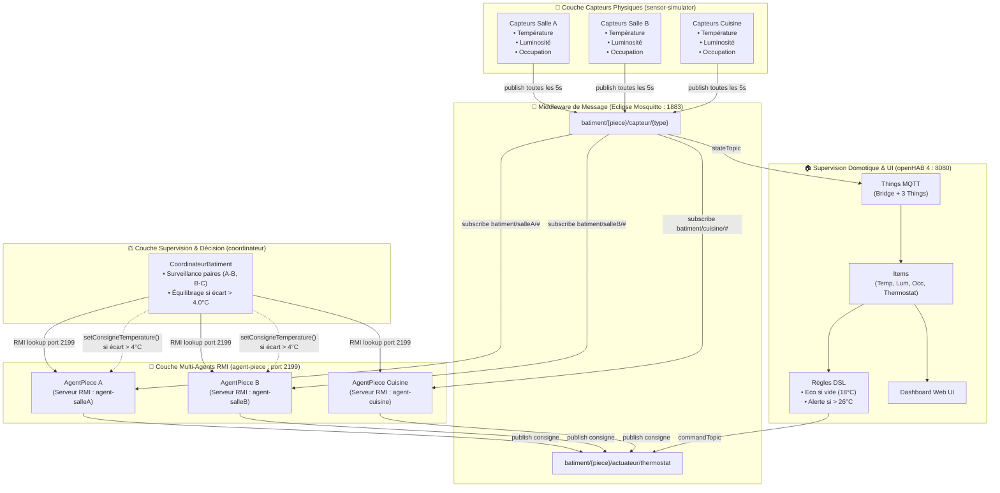
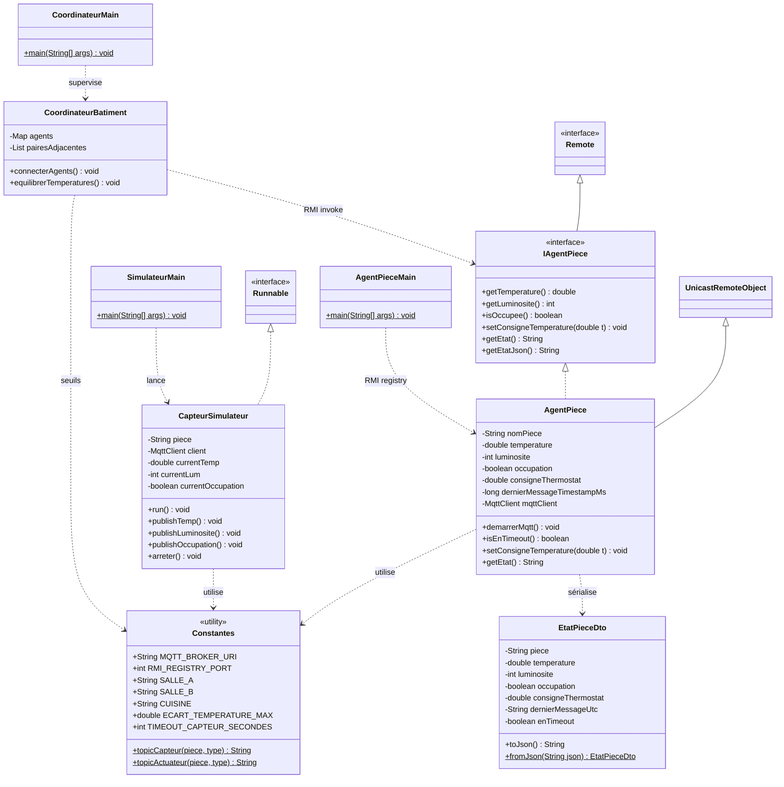
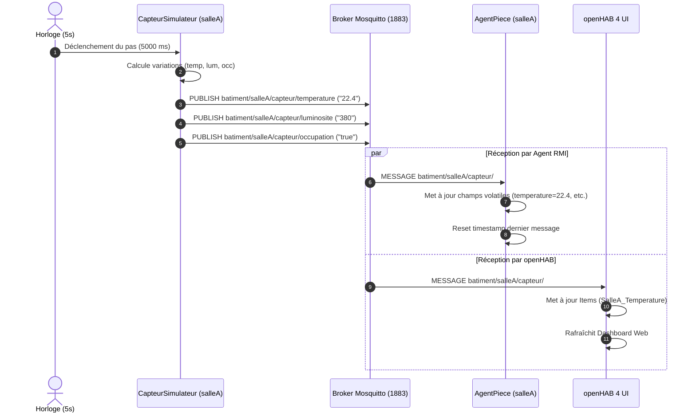
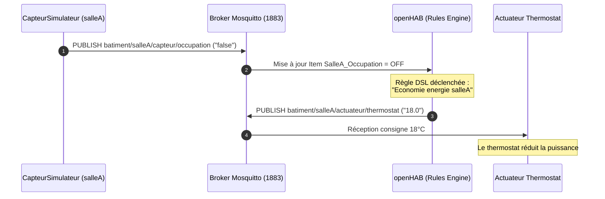
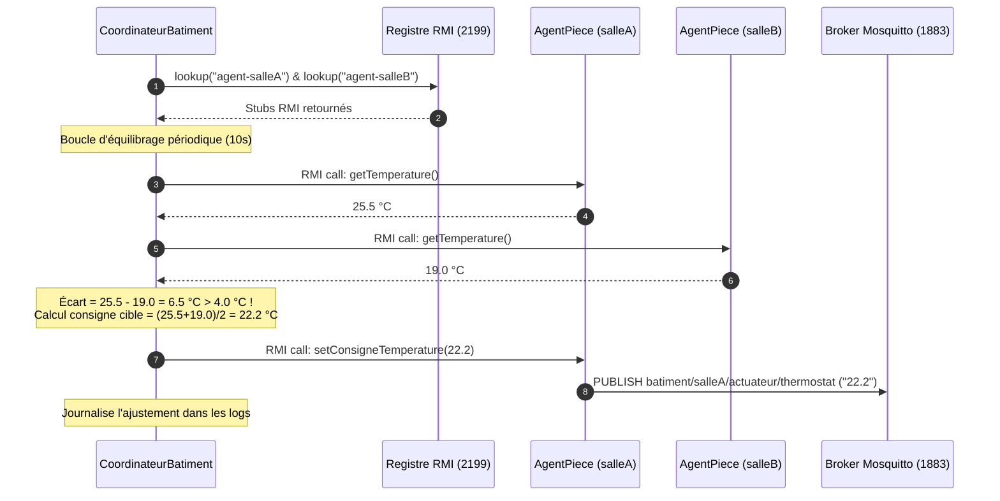
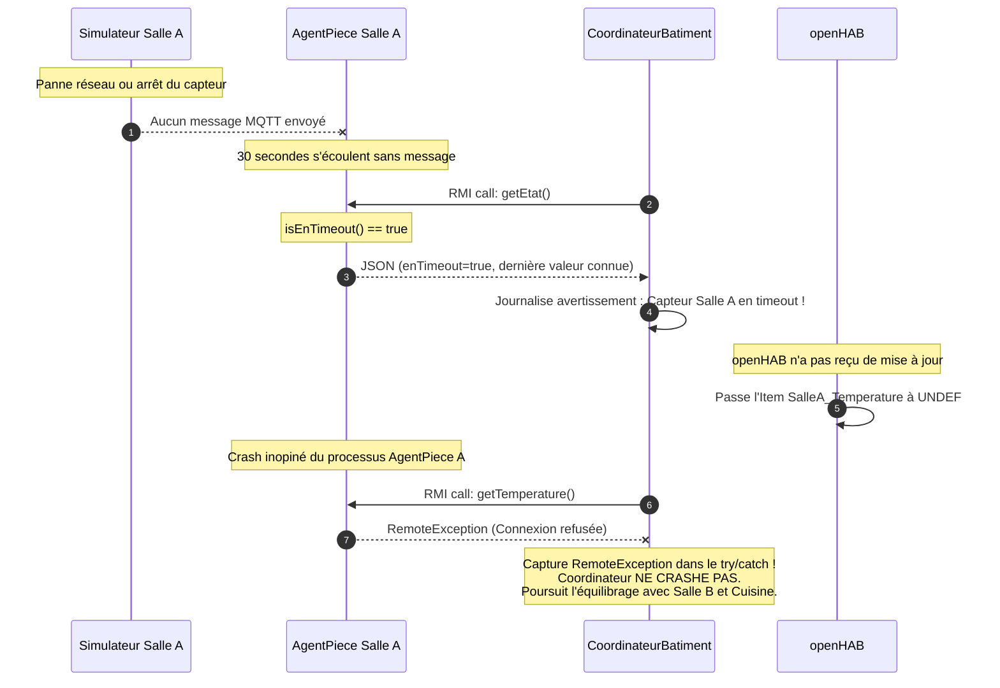

# 🏢 SmartAgent-IoT — Plateforme Domotique Multi-Agents

> **Cours :** IFT605 / IFT713 — Systèmes Répartis et Multi-Agents  
> **Institution :** Université de Sherbrooke — Faculté des sciences  
> **Enseignante :** Amal Ben Abdellah  
> **Auteurs :** Mohammed Nechba & Sasha Martineau
> **Technologies clés :** Java 21, Eclipse Mosquitto (MQTT), openHAB 4, Java RMI, Maven  

---

## 📑 Table des matières
1. [Vue d'ensemble et Objectifs du Projet](#1-vue-densemble-et-objectifs-du-projet)
2. [Architecture Globale du Système (Diagramme Mermaid)](#2-architecture-globale-du-système)
3. [Conception Détaillée des Composants](#3-conception-détaillée-des-composants)
4. [Diagramme de Classes UML (Mermaid)](#4-diagramme-de-classes-uml)
5. [Diagrammes de Séquence (Mermaid)](#5-diagrammes-de-séquence)
   - [Scénario 1 : Flux nominal des capteurs vers openHAB](#scénario-1--flux-nominal-des-capteurs)
   - [Scénario 2 : Règle domotique openHAB (Économie d'énergie)](#scénario-2--règle-domotique-openhab)
   - [Scénario 3 : Équilibrage thermique automatique par le Coordinateur](#scénario-3--équilibrage-thermique-par-le-coordinateur)
   - [Scénario 4 : Tolérance aux pannes (Timeout capteur & Crash RMI)](#scénario-4--tolérance-aux-pannes-et-résilience)
6. [Structure Modulaire du Répertoire Git](#6-structure-modulaire-du-répertoire-git)
7. [Feuille de Route & Étapes de Réalisation (S1, S2, S3)](#7-feuille-de-route--étapes-de-réalisation)
8. [Répartition des Tâches entre Binômes](#8-répartition-des-tâches-entre-binômes)
9. [Guide de Démarrage et Commandes d'Exécution](#9-guide-de-démarrage-et-commandes-dexécution)
10. [Grille d'Évaluation & Préparation de la Démonstration](#10-grille-dévaluation--préparation-de-la-démonstration)

---

## 1. Vue d'ensemble et Objectifs du Projet

Le projet **SmartAgent-IoT** a pour but d'implémenter l'infrastructure logicielle répartie d'un étage de bâtiment intelligent comportant **3 pièces** :
- `salleA`
- `salleB`
- `cuisine`

Chaque pièce comporte 3 capteurs physiques (température, luminosité, détection de présence/occupation) et 1 actuateur principal (thermostat de chauffage).

### Les deux paradigmes distribués exploités :
1. **Publish/Subscribe asynchrone (MQTT via Eclipse Mosquitto sur le port 1883) :**
   - Collecte massive et découplée des données capteurs.
   - Transmission des ordres de consigne aux actuateurs.
2. **Appel distant synchrone (Java RMI sur le port 2199) :**
   - Coopération pair-à-pair et supervision hiérarchique entre agents logiciels autonomes.
   - Consultation d'état atomique et pilotage par un coordinateur central.

---

## 2. Architecture Globale du Système



---

## 3. Conception Détaillée des Composants

### 3.1. Convention des Topics MQTT
Conformément aux exigences de l'énoncé, l'arborescence des topics est standardisée :
- **Mesures de capteurs (Publiées toutes les 5s) :**
  - `batiment/{piece}/capteur/temperature` (ex: `22.4`)
  - `batiment/{piece}/capteur/luminosite` (ex: `380`)
  - `batiment/{piece}/capteur/occupation` (`true` ou `false`)
- **Commandes d'actuateurs (Publiées sur décision RMI ou règle openHAB) :**
  - `batiment/{piece}/actuateur/thermostat` (ex: `19.0`)

### 3.2. Contrat RMI (`IAgentPiece`)
Chaque agent de pièce expose l'interface distante suivante :
```java
public interface IAgentPiece extends Remote {
    double getTemperature() throws RemoteException;
    int    getLuminosite() throws RemoteException;
    boolean isOccupee() throws RemoteException;
    void   setConsigneTemperature(double t) throws RemoteException;
    String getEtat() throws RemoteException;     // Format JSON
    String getEtatJson() throws RemoteException; // Alias explicite
}
```

### 3.3. Politique d'Équilibrage Thermique (Coordinateur)
- Le bâtiment est modélisé sous forme d'un graphe linéaire de pièces adjacentes :
  - Paire 1 : `salleA` ⟷ `salleB`
  - Paire 2 : `salleB` ⟷ `cuisine`
- **Règle :** Si $|\text{Temp}_1 - \text{Temp}_2| > 4.0^\circ\text{C}$ :
  1. Identifier la pièce la plus chaude.
  2. Calculer une consigne cible : $T_{\text{cible}} = \frac{T_1 + T_2}{2}$.
  3. Appeler `agentPlusChaud.setConsigneTemperature(T_cible)` via RMI.
  4. L'agent publie immédiatement cette consigne sur MQTT (`batiment/{piece}/actuateur/thermostat`).
  5. Journaliser l'événement (pièces, températures, décision, consigne).

### 3.4. Gestion de la Concurrence et Thread-Safety
- **Problématique :** Dans `AgentPiece`, le thread d'écoute réseau MQTT (callback Paho) écrit les données des capteurs, tandis que les threads du pool RMI lisent ces données simultanément.
- **Solution :** Utilisation de variables primitives déclarées `volatile` (`temperature`, `luminosite`, `occupation`, `consigneThermostat`) pour garantir la visibilité mémoire immédiate entre threads sans bloquer les performances.

---

## 4. Diagramme de Classes UML



---

## 5. Diagrammes de Séquence

### Scénario 1 : Flux nominal des capteurs
Ce diagramme illustre la publication périodique des données capteurs et leur propagation vers l'Agent RMI et openHAB.



---

### Scénario 2 : Règle domotique openHAB
Ce diagramme montre comment openHAB applique automatiquement une politique d'économie d'énergie dès qu'une pièce devient inoccupée.



---

### Scénario 3 : Équilibrage thermique par le Coordinateur
Ce diagramme détaille la décision du coordinateur central qui détecte un écart excessif ($> 4^\circ\text{C}$) entre deux pièces voisines.



---

### Scénario 4 : Tolérance aux pannes et résilience
Ce diagramme illustre le comportement du système lors de deux types de défaillances prévues par l'énoncé : coupure d'un capteur MQTT et plantage d'un agent RMI.



---

## 6. Structure Modulaire du Répertoire Git

```text
smartagent-iot/
├── pom.xml                               <-- POM Parent (Java 21, dépendances communes)
├── .gitignore                            <-- Exclusion target/, .idea, logs
├── README.md                             <-- Conception complète & guide
│
├── common-api/                           <-- Contrat d'interface et constantes partagées
│   ├── pom.xml
│   └── src/main/java/ca/usherbrooke/smartagent/api/
│       ├── IAgentPiece.java              <-- Interface RMI distante
│       ├── Constantes.java               <-- Ports, noms, topics MQTT, seuils
│       └── EtatPieceDto.java             <-- Sérialisation JSON et DTO
│
├── sensor-simulator/                     <-- Simulateur de capteurs MQTT
│   ├── pom.xml
│   └── src/main/java/ca/usherbrooke/smartagent/sensor/
│       ├── CapteurSimulateur.java        <-- Générateur de flux (temp, lum, occ)
│       └── SimulateurMain.java           <-- Lance les 3 threads de pièces
│
├── agent-piece/                          <-- Agents de pièces RMI
│   ├── pom.xml
│   └── src/main/java/ca/usherbrooke/smartagent/agent/
│       ├── AgentPiece.java               <-- Serveur RMI + client MQTT
│       └── AgentPieceMain.java           <-- Registre RMI (2199) + 3 agents
│
├── coordinateur/                         <-- Super-agent central
│   ├── pom.xml
│   └── src/main/java/ca/usherbrooke/smartagent/coordinator/
│       ├── CoordinateurBatiment.java     <-- Algorithme d'équilibrage (>4°C)
│       └── CoordinateurMain.java         <-- Boucle de supervision
│
├── openhab-config/                       <-- Configurations openHAB 4
│   ├── things/batiment.things            <-- Bridge Mosquitto + 3 Things
│   ├── items/batiment.items              <-- Items associés aux canaux MQTT
│   └── rules/batiment.rules              <-- Règles DSL (éco énergie + alerte)
│
├── scripts/                              <-- Automatisation de lancement
│   ├── start-all.ps1                     <-- Démarre toute la plateforme
│   └── stop-all.ps1                      <-- Arrête les processus
│
└── doc/                                  <-- Documentation pour le rapport final
    └── diagrams/                         <-- Diagrammes exportés
```

---

## 7. Feuille de Route & Étapes de Réalisation

### 📅 Semaine 1 : Infrastructure IoT & openHAB
1. **Étape 1.1 :** Démarrer le broker local Mosquitto (`mosquitto -v` sur le port 1883).
2. **Étape 1.2 :** Compiler et tester `sensor-simulator`. Vérifier les 9 flux MQTT avec `mosquitto_sub -t "batiment/#" -v`.
3. **Étape 1.3 :** Copier les fichiers `openhab-config/` dans le répertoire openHAB (`conf/things`, `conf/items`, `conf/rules`).
4. **Étape 1.4 :** Valider dans l'interface openHAB que les valeurs s'actualisent en temps réel et que la règle d'économie d'énergie se déclenche quand l'occupation passe à `OFF`.

### 📅 Semaine 2 : Agents Distribués Java RMI
1. **Étape 2.1 :** Compiler `common-api` et vérifier l'interface `IAgentPiece`.
2. **Étape 2.2 :** Implémenter et lancer `agent-piece` sur le port RMI 2199. Vérifier avec un test client que les méthodes `getTemperature()`, `getLuminosite()`, `isOccupee()` retournent les valeurs lues sur MQTT.
3. **Étape 2.3 :** Vérifier que `setConsigneTemperature()` publie bien sur `batiment/{piece}/actuateur/thermostat`.
4. **Étape 2.4 :** Lancer `coordinateur`. Créer un écart volontaire $> 4^\circ\text{C}$ (par exemple en forçant une valeur) et observer l'ajustement automatique dans les logs.

### 📅 Semaine 3 : Intégration, Tests & Rapport
1. **Étape 3.1 :** Tester le timeout de 30 secondes en coupant un simulateur de pièce et vérifier l'affichage `UNDEF` dans openHAB.
2. **Étape 3.2 :** Simuler le crash d'un agent RMI et vérifier que le coordinateur capture `RemoteException` sans s'arrêter.
3. **Étape 3.3 :** Rédiger le rapport de 8 à 12 pages (en réutilisant ce README, les diagrammes Mermaid et les explications d'architecture).
4. **Étape 3.4 :** Répéter le script de démonstration de 10 minutes.

---

## 8. Répartition des Tâches entre Binômes

Pour maximiser l'efficacité sans conflit Git :

| Rôle | Étudiant Responsable | Tâches Assignées |
| :--- | :--- | :--- |
| **Binôme A** | **Responsable IoT & openHAB** | • Module `sensor-simulator` (génération réaliste des 9 flux MQTT).<br>• Configuration openHAB (`batiment.things`, `batiment.items`, `batiment.rules`).<br>• Vérification de l'UI openHAB et des règles DSL d'automatisation. |
| **Binôme B** | **Responsable RMI & Coordination** | • Module `common-api` (`IAgentPiece`, `EtatPieceDto`, `Constantes`).<br>• Module `agent-piece` (Serveur RMI, binding port 2199, abonné MQTT).<br>• Module `coordinateur` (Algorithme d'équilibrage thermique, paires adjacentes). |
| **En commun** | **Mohammed & Binôme** | • Tests de tolérance aux pannes (timeout 30s, crash agent RMI).<br>• Tests unitaires JUnit.<br>• Rédaction du rapport PDF final (8-12 pages).<br>• Démonstration live de 10 min. |

---

## 9. Guide de Démarrage et Commandes d'Exécution

### Prérequis
- **Java 21** (`java -version`)
- **Maven 3.8+** (`mvn -version`)
- **Eclipse Mosquitto** (`mosquitto -v`)
- **openHAB 4** (optionnel pour les tests Java purs, requis pour l'UI et les règles DSL)

### Compilation globale du projet
Depuis la racine `smartagent-iot/` :
```bash
mvn clean package
```

### Lancement étape par étape

#### 1. Démarrer le Broker MQTT
```bash
mosquitto -v
```

#### 2. Lancer les Agents RMI
```bash
mvn -pl agent-piece exec:java -Dexec.mainClass="ca.usherbrooke.smartagent.agent.AgentPieceMain"
```

#### 3. Lancer le Simulateur de Capteurs
```bash
mvn -pl sensor-simulator exec:java -Dexec.mainClass="ca.usherbrooke.smartagent.sensor.SimulateurMain"
```

#### 4. Lancer le Coordinateur Central
```bash
mvn -pl coordinateur exec:java -Dexec.mainClass="ca.usherbrooke.smartagent.coordinator.CoordinateurMain"
```

#### 5. Script PowerShell automatique (Windows)
Pour tout démarrer en une seule commande :
```powershell
.\scripts\start-all.ps1
```

---

## 10. Grille d'Évaluation & Préparation de la Démonstration

### Barème (/100 points)
- **MQTT — Pub/Sub (15 pts) :** Capteurs publient correctement, agents s'abonnent et lisent les valeurs.
- **openHAB Things & Items (10 pts) :** Things MQTT + Items correctement configurés, mesures visibles dans l'UI.
- **openHAB Rules (10 pts) :** $\ge 2$ règles DSL fonctionnelles (économie énergie + alerte).
- **Java RMI (20 pts) :** Interface distante + 3 serveurs AgentPiece enregistrés dans le registre RMI (port 2199).
- **Coordinateur (10 pts) :** Politique d'équilibrage thermique correcte via RMI ($> 4^\circ\text{C}$).
- **Tolérance aux pannes (10 pts) :** Gestion du timeout 30s MQTT + reprise sur erreur `RemoteException`.
- **Rapport PDF (15 pts) :** Architecture claire, diagrammes, justification des choix (8–12 pages).
- **Démonstration (10 pts) :** Maîtrise, fluidité, réponse aux questions pendant les 10 minutes.

### Script de la Démonstration (10 minutes chrono)
1. **[0-2 min] Lancement :** Démarrer Mosquitto, les 3 agents RMI et le coordinateur.
2. **[2-3 min] Visualisation openHAB :** Montrer les mesures en direct dans l'UI web openHAB.
3. **[3-5 min] Automatisation openHAB :** Simuler l'inoccupation d'une pièce $\rightarrow$ la règle DSL baisse le thermostat à 18°C.
4. **[5-7 min] Équilibrage Coordinateur :** Créer un déséquilibre $> 4^\circ\text{C}$ $\rightarrow$ le coordinateur détecte et compense automatiquement.
5. **[7-9 min] Tolérance aux pannes :** Couper un flux MQTT (timeout 30s et état UNDEF) puis tuer un agent RMI (le coordinateur continue son cycle sans crasher).
6. **[9-10 min] Questions :** Réponses aux questions de l'enseignante.
